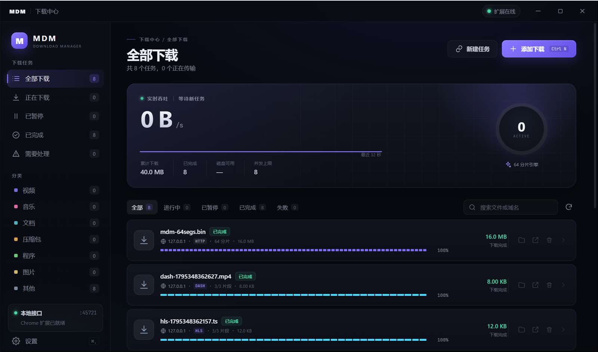

# MDM · 多协议下载管理器

MDM 是一个类似 NDM 的桌面下载管理器：Rust + Tauri 2 后端负责下载引擎，React 19 提供中文深色界面，Chrome MV3 扩展把浏览器下载自动接管到本地 MDM。

- 最高 **64 路 HTTP Range 分片**并发下载（自动按文件大小与服务器能力降级）
- 协议：HTTP / HTTPS、FTP、HLS（m3u8）、DASH（mpd）
- HLS **AES-128** 解密、fMP4/TS 分片合并；可选调用 ffmpeg 转封装 / 合并 DASH 音视频
- 暂停、继续、重试、取消、队列并发控制、断点续传、SHA-256 校验
- 单任务限速、全局限速、分类、搜索、64 格分片可视化、拖拽链接添加
- 本地回环 HTTP API（仅 127.0.0.1）+ 令牌鉴权，供 Chrome 扩展和第三方调用
- Chrome MV3 扩展：接管下载、右键媒体、Cookie 转发、连接状态、最近任务
- Tauri 2 外壳：安装包/可执行文件体积远小于 Electron，使用系统 WebView2



> 截图：HTTP 64 分片任务与 DASH/HLS 流媒体任务均已完成。

## 快速开始

### 1. 环境

- Node.js 20+、npm 10+
- Rust stable（Windows GNU 工具链示例：`rustup target add x86_64-pc-windows-gnu`，并准备 MinGW-w64 的 `gcc`/`ar`/`windres`）
- 可选：`ffmpeg` 加入 PATH；HLS/DASH 的分片合并与音视频合并会用到

### 2. 安装与构建

```bash
npm install
npm run typecheck
npm run extension:check
npm run tauri:build
```

Windows GNU 目标需要把 MinGW 的 `bin` 放进 PATH，并让 Cargo 使用 GNU 工具链。构建产物：

```text
src-tauri/target/x86_64-pc-windows-gnu/release/mdm.exe
```

安装包（NSIS）在本地可运行 `npm run tauri:bundle`（Windows GNU 工具链）。

### 2.1 用 GitHub Actions 构建安装包

仓库已提供 [.github/workflows/build.yml](.github/workflows/build.yml)：

- Pull Request：自动执行 `npm ci`、TypeScript 类型检查和 Chrome 扩展结构校验。
- 手动触发（Actions → build → Run workflow）或推送 `v*` 标签：在 `windows-latest` 上使用 Rust MSVC 工具链构建 NSIS 安装包，并上传 `mdm-windows` artifact，其中包含安装包和免安装 `mdm.exe`。
- CI 不需要本地 MinGW，也不依赖本地 Windows GNU 测试运行器。

> 仓库已初始化并推送到 GitHub；在 Actions 页面手动运行 `build`，或推送 `v*` 标签即可构建。构建产物在对应运行的 Artifacts 区域下载。

### 3. 启动

直接运行上面的 `mdm.exe`。数据目录默认是 Tauri 的应用数据目录（Windows 通常为 `%APPDATA%\com.mdm.downloadmanager`），其中包含：

- `tasks.json` / `settings.json`：任务与设置
- `api-token`：本地 API 令牌
- `fragments/`：流媒体分片临时目录

### 4. 安装 Chrome 扩展

1. 打开 `chrome://extensions`，开启「开发者模式」。
2. 点「加载已解压的扩展程序」，选择仓库的 `extension/` 目录。
3. 启动 MDM，在桌面端「设置 → Chrome 扩展」复制令牌。
4. 打开扩展的「设置连接」，填入端口（默认 45721）与令牌，测试并保存。
5. 之后在 Chrome 中下载文件会自动转到 MDM；也可右键链接/视频选择「使用 MDM 下载此链接 / 媒体」。

> 如果 MDM 没有运行，扩展会放行 Chrome 原生下载，不会把文件弄丢。

## 项目结构

```text
src-tauri/            Rust 下载引擎与 Tauri 外壳
  src/engine/         HTTP Range、FTP、HLS、DASH、探测、分片、ffmpeg
  src/manager.rs      任务状态机、队列、持久化、进度
  src/api.rs          127.0.0.1 HTTP API（axum）
  src/lib.rs          Tauri 命令、窗口、剪贴板、打开目录
src/renderer/         React 19 中文界面（Tauri 使用 tauri-shim）
src/shared/           前后端共享类型
extension/            Chrome MV3 扩展（popup / options / service worker）
docs/                 架构、API、扩展、路线图
src/main/             Electron 旧实现（仅作迁移参考，不参与 Tauri 构建）
```

## API 摘要

服务只监听 `127.0.0.1`，除 `/api/v1`、`/api/v1/ping` 外都需要令牌：

```http
GET  /api/v1/tasks
POST /api/v1/tasks
GET  /api/v1/tasks/{id}
POST /api/v1/tasks/{id}/pause|resume|cancel|retry
GET  /api/v1/health
GET  /api/v1/stats
```

请求头：`X-MDM-Token: <token>` 或 `Authorization: Bearer <token>`。详见 [docs/API.md](docs/API.md)。

## 已知限制

- HLS：不支持直播（无 `ENDLIST`）、SAMPLE-AES / DRM、备用音轨、EXT-X-MAP BYTERANGE。
- DASH：仅第一个 Period，SegmentTemplate 只做一层继承，SegmentTimeline 的 `r=-1` 只展开一次；DRM 拒绝。
- FTP：单连接；FTPS 尚未实现；服务器拒绝 REST 时自动从头重下。
- 没有 BitTorrent、ed2k、磁力、浏览器内视频嗅探、计划任务、系统托盘、自动更新。
- Windows 为主要目标平台；macOS/Linux 打包未配置。
- 分片并发 64 只适用于支持 Range 的 HTTP(S) 文件；流媒体分片并发上限为 8。

## 安全说明

- API 只绑定回环地址，令牌随机 32 字节并写入本地文件；请勿把端口暴露到公网。
- 扩展会转发当前站点 Cookie 到本机，仅用于需要登录的下载；可在扩展设置关闭。
- 应用没有遥测，不上传任务数据。

## 文档

- [架构](docs/ARCHITECTURE.md)
- [API](docs/API.md)
- [Chrome 扩展](docs/CHROME-EXTENSION.md)
- [路线图](docs/ROADMAP.md)

## License

MIT
